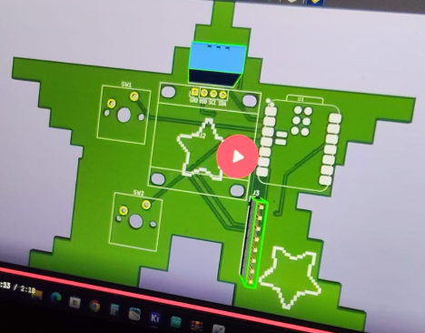
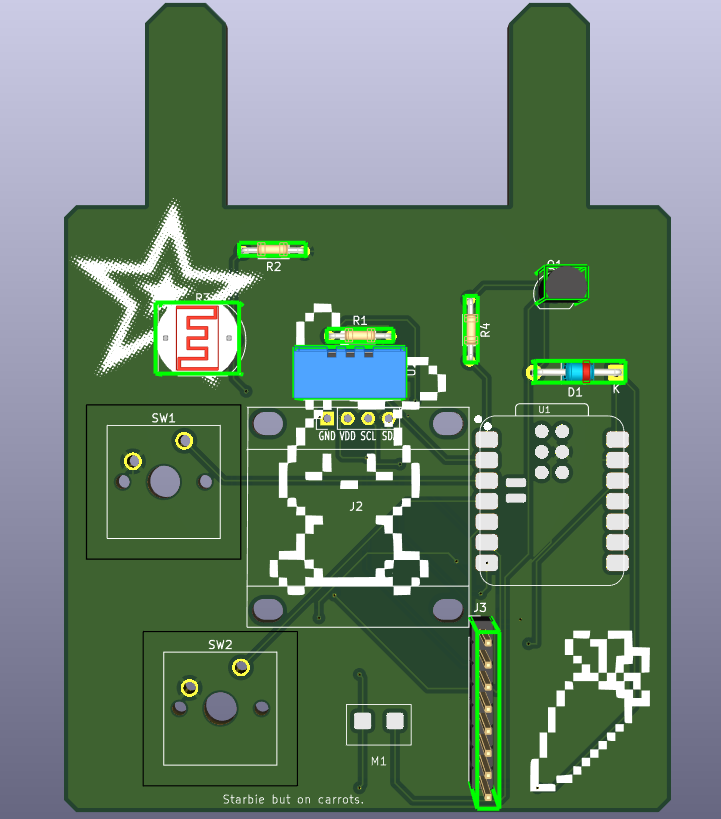
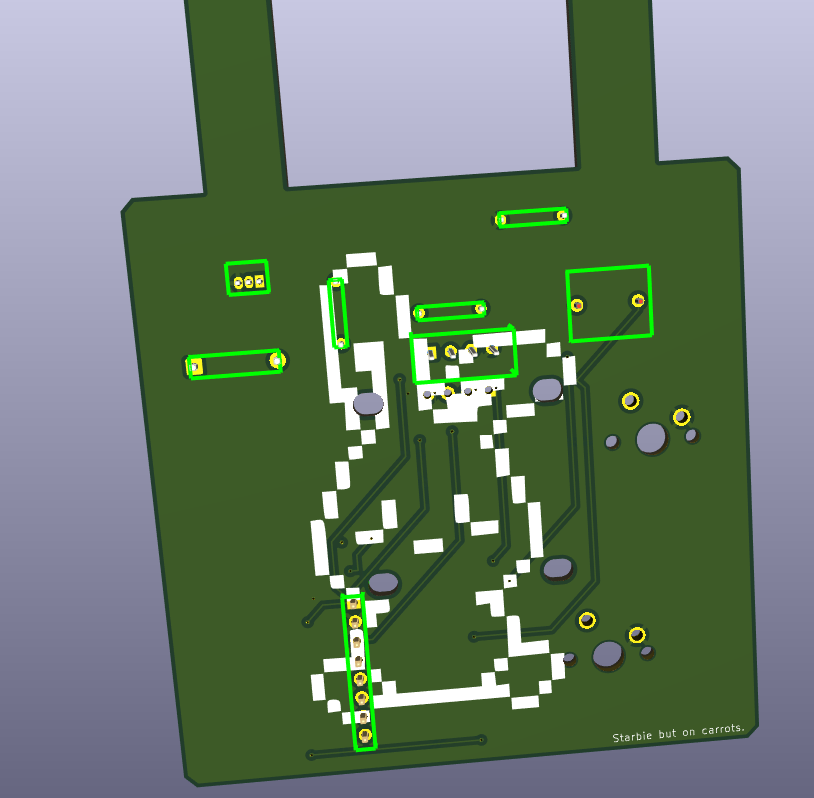

First, some files are called star, as i intended to make starbie but changed my opinion.

Second, i did a very bad mistake by building up the time until i got to work on this project for 6 hours in a single day and it wasn't the best experience. Luckily, i knew how to deal with KiCad but later on, i won't be able to deal with CADing.

First thing i did in that project was following the project without changing anything 
Those are photos of what i have done.

I followed the tutorial and made the whole star in about 2-2.5 hours
After having some rest, i continued on this project but decided to continue with a bunny instead of star because why not (Idk the reason tbh)

After spending 3 hours on fixing bugs and adding other circuits (I only added LDR and haptic motor), I finished with those. And i admit they were so impressive and i was proud
  

Spent the rest of the time preparing the code by adding some conditions like forcing sleeping when there is no to little amount of light using LDR and followed the rest of the tutorial. In addition, i added my rabbit pet instead of the pet that was provided in the tutorial.
Finally, i set up github to publish this and future projects.
(i know git was supposed to be done first, but it is what it is)